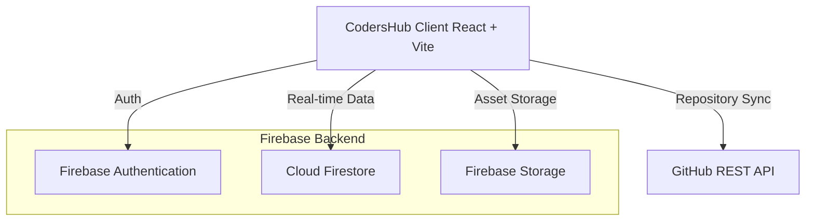

# CodersHub Presentation Guide

Welcome to the official presentation guide for **CodersHub**—a premium, highly interactive web application designed as a professional networking and project-sharing ecosystem for student coders, developers, and early-stage entrepreneurs. 

This guide is structured as an interactive slide deck template. It includes slide-by-slide outlines, professional talking points, technical insights, and a live demo script to ensure your presentation is a stellar success.

---



---

## 🛝 Slide Deck Structure

### 🎫 Slide 1: Title & Vision
* **Heading**: CodersHub: Empowering the Next Generation of Developers
* **Sub-heading**: A Professional Networking & Project Collaboration Platform
* **Visual Ideas**: A modern mockup of the application's feed or project dashboard with sleek gradient styling.
* **Core Talking Points**:
  * Introduce **CodersHub** as a highly polished, responsive web application designed for students and developers to bridge the gap between building projects and building networks.
  * Explain the core vision: It acts as an academic/collaborative hybrid combining the social connectivity of **LinkedIn** with the code-sharing capabilities of **GitHub**.
  * It provides a dedicated workspace for developers to showcase their work, discover co-founders, join university communities, and chat in real-time.

---

### ❓ Slide 2: The Problem & The Solution
* **Heading**: Bridging the Gap in Developer Collaboration
* **Table of Comparison**:
  | The Problem (Existing Platforms) | The CodersHub Solution |
  | :--- | :--- |
  | **Scattered Profiles**: Portfolios on GitHub, resumes on LinkedIn, chat on Discord. | **Unified Playground**: A single profile showing projects, skills, interest domains, and messaging. |
  | **High Friction Project Sharing**: Manually creating screenshots, writing posts, linking code. | **Instant GitHub Sync**: Enter a repo URL; the platform automatically imports repository details and assets. |
  | **Hard to Find Co-Founders**: Hard to discover classmates with matching tech interests. | **Co-Founder & Startup Hub**: Dedicated hub to match founders with developers looking for roles. |
* **Core Talking Points**:
  * Developers build amazing things, but presenting them to peers and finding like-minded collaborators is highly fragmented.
  * CodersHub lowers the friction of sharing by introducing automated imports, and optimizes networking by categorizing students by college, interest domain, and coding skills.

---

### 🛠️ Slide 3: Tech Stack & System Architecture
* **Heading**: A Modern, High-Performance Tech Stack
* **Bullet Points**:
  * **Frontend Core**: React 19 (Component-based architecture) & Vite 8 (Ultra-fast dev server and HMR).
  * **Design & Styling**: Tailwind CSS v4, custom vanilla CSS variables, and Google Fonts typography (Inter/Outfit).
  * **Interactive Micro-Animations**: Framer Motion for smooth transitions, slide-ins, and hover states.
  * **State & Data Binding**: React hooks coupled with real-time Firebase listeners.
  * **Database & Auth (Backend-as-a-Service)**: Firebase 9 SDK (Firestore NoSQL DB, Authentication, Storage).
  * **Third-Party API**: GitHub REST API for automated repo metadata and topic queries.
* **Core Talking Points**:
  * CodersHub is engineered using state-of-the-art web technologies. React 19 provides modern hooks and rendering capabilities.
  * Using Firebase 9 allows real-time synchronization. When a user posts a comment or likes a project, the updates propagate instantly across the platform without requiring full-page reloads.

---

### 🎨 Slide 4: Feature Deep-Dive (Part 1)
* **Heading**: Premium Interactive Social Feed & Network
* **Layout Layout Outline**:
  > [!NOTE]
  > **Core Components in Feed:**
  > 1. **Interactive Event Slideshow Sidebar**: Automated slideshow highlighting campus meetups, hackathons, and webinars.
  > 2. **Dynamic Stories Carousel**: An Instagram-like story bubble tray supporting full-screen image and rich-text student updates.
  > 3. **Social Feed Board**: Users can write posts, attach local device images, like, comment in real-time, and share.
  > 4. **CodeMates Sidebar**: Intelligent networking card offering recommendations to connect with developers.
* **Core Talking Points**:
  * The landing experience is a dynamic social feed modeled after modern social nets, tailored specifically for tech students.
  * The **Event Slideshow** keeps campus engagement high.
  * The **Stories** component allows quick, ephemeral showcases of what students are building right now.

---

### 💻 Slide 5: Feature Deep-Dive (Part 2)
* **Heading**: Smart Project Showcase & Co-Founder Hub
* **Callout Details**:
  > [!IMPORTANT]
  > **Key Innovative Features:**
  > * **GitHub REST Lookup**: Entering a repo URL (e.g., `https://github.com/owner/repo`) queries the GitHub API. It retrieves repository name, description, tags/topics, and owner profile picture automatically.
  > * **Featured Showcases**: The top three projects in the database receive dynamic **Featured** badges, glowing blue borders, and elevated shadows to highlight high-quality community work.
  > * **Co-Founder Startup Hub**: A launchpad where startup founders define their vision, post their seed details, and list required roles (e.g., "AI Engineer," "UI/UX Designer") with instant joining applications.
* **Core Talking Points**:
  * The GitHub upload is a game-changer. Students don't need to fill out long forms; the platform does the heavy lifting of importing topics and descriptions.
  * The **Featured** highlight gives developers a sense of achievement when their project gets highlighted on the main grid.
  * The Startup Hub acts as an incubator directory, matching talented developers directly with projects that need them.

---

### 💬 Slide 6: Real-Time Chat & Developer Profiles
* **Heading**: Real-Time Communication & Professional Identity
* **Architecture / Structure**:
  * **Real-time Messenger**:
    * Structured into **Communities** (e.g., Web Dev Community, AI/ML, Hackathon Finder) and **Direct Messages**.
    * Supports inline **markdown code snippet highlights** with dark-themed visual editor interfaces.
    * Real-time online/offline presence indicator.
  * **Profile Dashboard**:
    * Dynamic student profile outlining their college, bio, interested domains, and skills tags.
    * Integrates **client-side image compression** for avatar uploads to minimize Firebase Storage usage and boost performance.
    * Consolidates the student's uploaded projects and active startup affiliations.
* **Core Talking Points**:
  * Collaboration is incomplete without communication. Our real-time chat supports full formatting for code snippets, enabling students to peer-review and debug together directly within the app.
  * The Profile acts as the developer's resume. Local image compression guarantees that user-uploaded photos load instantly even on low-bandwidth networks.

---

### ⚙️ Slide 7: Database Schemas & Data Model
* **Heading**: Flexible, Real-Time NoSQL Schema (Firestore)
* **Code Highlight (JSON Data Models)**:
```json
// "profiles" Collection
{
  "uid": "user_auth_id_123",
  "fullName": "Jane Doe",
  "college": "Stanford University",
  "bio": "Full-stack engineer passionate about decentralized web.",
  "domains": ["Web Development", "Blockchain Development"],
  "imageUrl": "data:image/jpeg;base64,...", // Compressed avatar
  "socialLinks": { "github": "...", "linkedin": "..." }
}

// "projects" Collection
{
  "title": "Decentralized Finance Protocol",
  "desc": "An automated market maker built using React and Solidity.",
  "tech": ["React", "Solidity", "Tailwind"],
  "image": "https://...",
  "repoLink": "https://github.com/janedoe/defi-amm",
  "uid": "user_auth_id_123",
  "user": "Jane Doe",
  "userImg": "https://api.dicebear.com/...",
  "createdAt": "2026-05-20T06:00:00.000Z",
  "likedBy": ["uid_1", "uid_2"],
  "downloadsCount": 42,
  "comments": [
    {
      "uid": "uid_3",
      "userName": "Alex Smith",
      "userImg": "https://...",
      "text": "Brilliant smart contract optimization!",
      "createdAt": "2026-05-20T06:10:00.000Z"
    }
  ]
}
```
* **Core Talking Points**:
  * We designed a highly scalable NoSQL schema in Cloud Firestore.
  * Documents like `projects` embed sub-arrays/objects for comments and likes, optimizing read performance and reducing read-query costs while providing live synchronization listeners.

---

## 🎬 Live Demo Script

Follow this step-by-step walkthrough to give an immersive, flawless live demonstration of the system:

1. **Phase 1: The Landing Experience (Feed & Stories)**
   * **Action**: Open the dashboard (`/`). Show off the premium typography and layout.
   * **Talking Point**: *"Here is our landing feed. On the left sidebar, you see our campus events slideshow highlighting upcoming campus hackathons. On the top, you can click on any of these student stories to view full-screen, high-definition developer updates."*
   * **Action**: Click a story. Show the full-screen view. Close the story. Click "Start a post", type a message, upload an image, and hit "Post". Show it immediately prepending to the feed.

2. **Phase 2: Project Synchronization (The Wow Factor)**
   * **Action**: Navigate to the **Projects** tab. Show off the grid. Point out the glowing **Featured** projects on top.
   * **Talking Point**: *"Sharing projects is usually tedious. Watch how CodersHub simplifies it. Let's click 'Upload Project' and simply enter a GitHub URL."*
   * **Action**: Open the modal. Enter a GitHub URL (e.g. `https://github.com/facebook/react` or a mock repo). Click "Add Project". 
   * **Talking Point**: *"In the background, our app queries the GitHub API, grabs the stars, documentation topics, description, and adds it immediately to our database. It's instantly live!"*

3. **Phase 3: Real-Time Engagement & Chat**
   * **Action**: Click on the comments icon of the project you just created. Write a comment and watch it instantly appear. Like the project and show the like counter incrementing.
   * **Action**: Navigate to the **Messages** tab. Click on a community channel (like "Web Dev Community").
   * **Talking Point**: *"Once developers connect, they can immediately chat, review code, or share snippets. Look at this community channel where students have shared code blocks."*

4. **Phase 4: Profile Management**
   * **Action**: Go to the **Profile** tab. Click "Edit Profile". Search and select a few skills/domains. Change the bio. Upload a new profile picture. Hit "Save Changes".
   * **Talking Point**: *"Every student has their own central dashboard showing their skills, interested domains, active projects, and even their startup collaborations. Notice how fast and fluid the editing experience is."*

---

## 🚀 Future Roadmap & Scaling
* **AI Matchmaking**: Auto-matching students to startup teams using cosine-similarity on profile skill vectors.
* **Code Sandboxing**: Integrating an online compiler/sandbox to test user-uploaded projects directly in the browser.
* **Academic Integrations**: Enabling college faculty to host assignments and track student coding portfolios.
